# SS Writer

**Markdown & Text Editor** for Windows 11. Website: <https://sswriter.isolmaz.com>

[](https://github.com/isolmaz/ss-writer/actions/workflows/ci.yml)
[](https://github.com/isolmaz/ss-writer/releases/latest)
[](LICENSE)

<p align="center">
  <picture>
    <source media="(prefers-color-scheme: dark)" srcset="docs/screenshots/editor-overview-dark.png">
    <source media="(prefers-color-scheme: light)" srcset="docs/screenshots/editor-overview-light.png">
    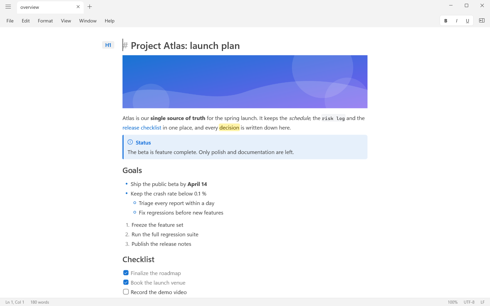
  </picture>
</p>

SS Writer is a native Windows 11 editor for Markdown and plain text, written in Rust. The window, menus, text rendering and input handling are built on Win32, Direct2D and DirectWrite. Markdown is rendered while you type: the markers (`**`, `#`, `[]()`) hide until the caret touches them, and the source is always one keystroke away.

The file on disk is the truth. SS Writer never writes markers of its own into your documents, and everything it remembers about them (session, caret positions, folds, version history) lives in its own data folder.

It opens and saves Markdown, plain text, Mermaid, TextBundle, DOCX, ODT and RTF, imports legacy Word `.doc` files, and exports to PDF, PNG, JPG, HTML, ePub, DOCX, ODT, RTF, TXT, Markdown with attachments and TextBundle. It is MIT licensed, has no telemetry, and the interface is in English.

## Screenshots

Screenshots follow your GitHub theme.

<table>
  <tr>
    <td width="50%">
      <picture>
        <source media="(prefers-color-scheme: dark)" srcset="docs/screenshots/editor-reveal-dark.png">
        <source media="(prefers-color-scheme: light)" srcset="docs/screenshots/editor-reveal-light.png">
        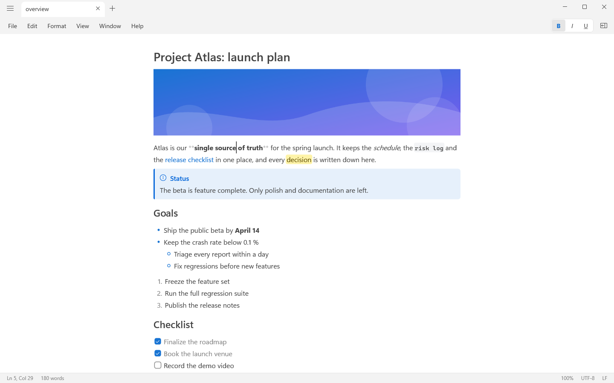
      </picture>
      <br><sub>Markers appear where the caret is.</sub>
    </td>
    <td width="50%">
      <picture>
        <source media="(prefers-color-scheme: dark)" srcset="docs/screenshots/sidebar-workspace-dark.png">
        <source media="(prefers-color-scheme: light)" srcset="docs/screenshots/sidebar-workspace-light.png">
        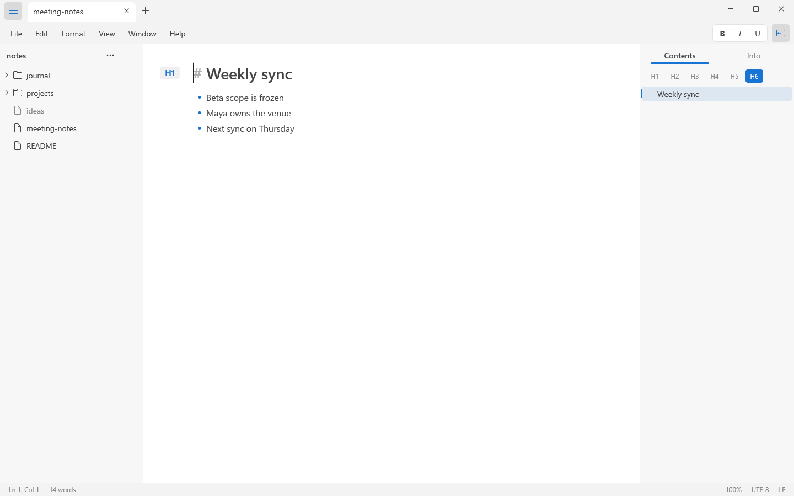
      </picture>
      <br><sub>Workspace sidebar and inspector.</sub>
    </td>
  </tr>
  <tr>
    <td width="50%">
      <picture>
        <source media="(prefers-color-scheme: dark)" srcset="docs/screenshots/table-editing-dark.png">
        <source media="(prefers-color-scheme: light)" srcset="docs/screenshots/table-editing-light.png">
        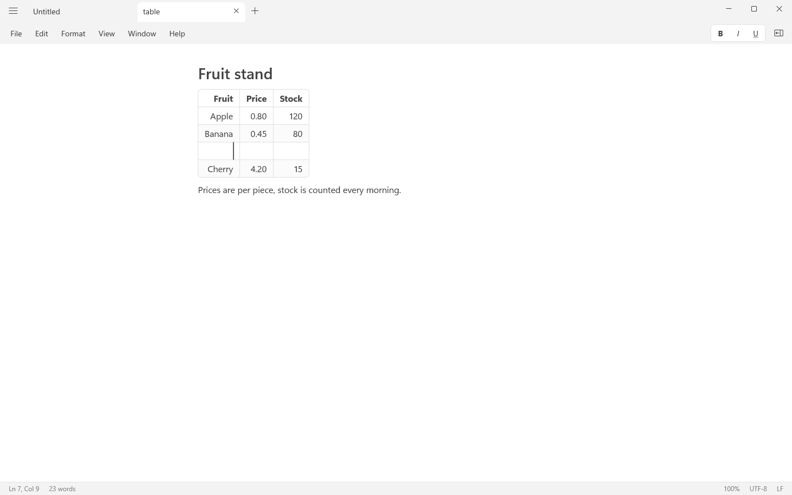
      </picture>
      <br><sub>Tables are edited in place.</sub>
    </td>
    <td width="50%">
      <picture>
        <source media="(prefers-color-scheme: dark)" srcset="docs/screenshots/mermaid-document-dark.png">
        <source media="(prefers-color-scheme: light)" srcset="docs/screenshots/mermaid-document-light.png">
        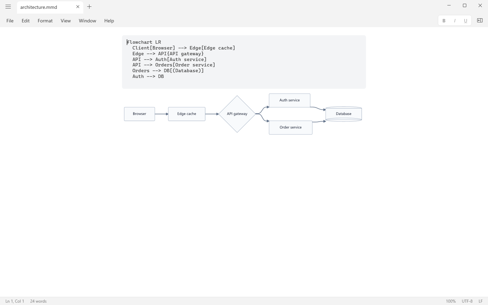
      </picture>
      <br><sub>A <code>.mmd</code> file: source and live diagram.</sub>
    </td>
  </tr>
  <tr>
    <td width="50%">
      <picture>
        <source media="(prefers-color-scheme: dark)" srcset="docs/screenshots/find-replace-dark.png">
        <source media="(prefers-color-scheme: light)" srcset="docs/screenshots/find-replace-light.png">
        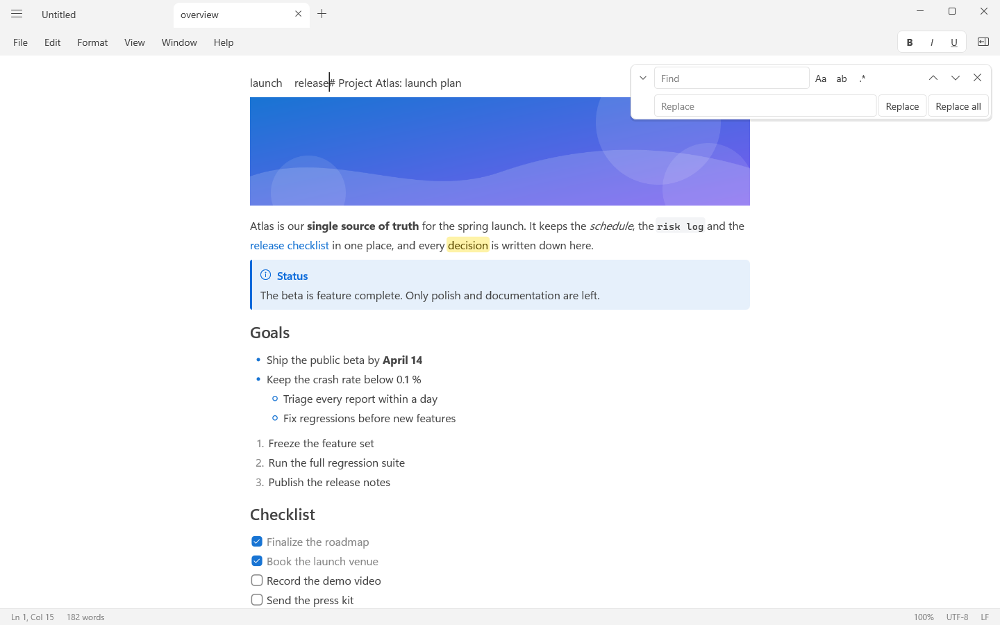
      </picture>
      <br><sub>Find and replace.</sub>
    </td>
    <td width="50%">
      <picture>
        <source media="(prefers-color-scheme: dark)" srcset="docs/screenshots/command-palette-dark.png">
        <source media="(prefers-color-scheme: light)" srcset="docs/screenshots/command-palette-light.png">
        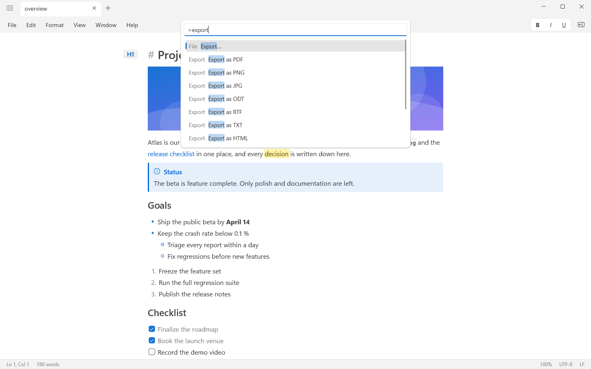
      </picture>
      <br><sub>Command palette.</sub>
    </td>
  </tr>
  <tr>
    <td width="50%">
      <picture>
        <source media="(prefers-color-scheme: dark)" srcset="docs/screenshots/quick-open-dark.png">
        <source media="(prefers-color-scheme: light)" srcset="docs/screenshots/quick-open-light.png">
        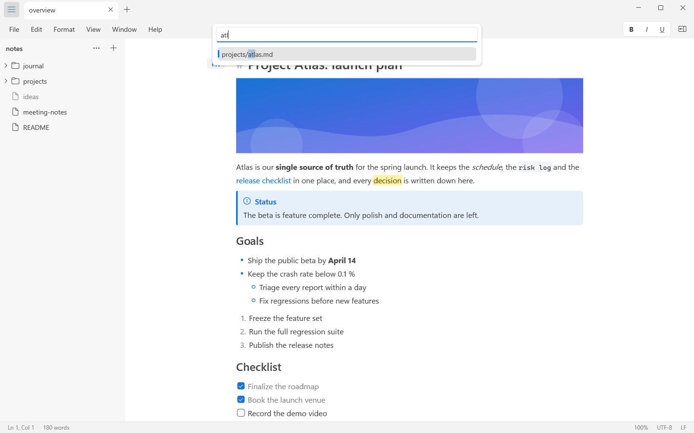
      </picture>
      <br><sub>Quick Open.</sub>
    </td>
    <td width="50%">
      <picture>
        <source media="(prefers-color-scheme: dark)" srcset="docs/screenshots/zen-focus-dark.png">
        <source media="(prefers-color-scheme: light)" srcset="docs/screenshots/zen-focus-light.png">
        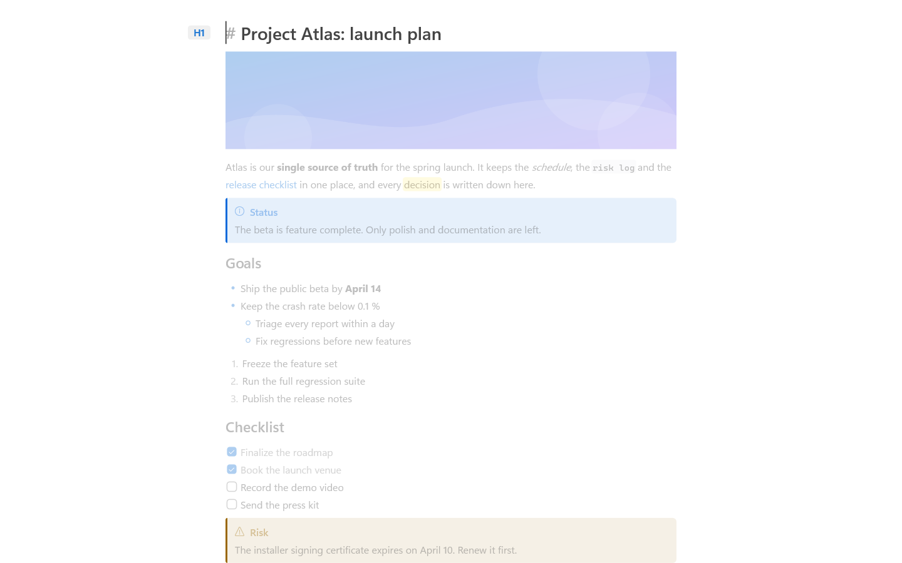
      </picture>
      <br><sub>Focus mode inside zen mode.</sub>
    </td>
  </tr>
  <tr>
    <td width="50%">
      <picture>
        <source media="(prefers-color-scheme: dark)" srcset="docs/screenshots/export-dialog-dark.png">
        <source media="(prefers-color-scheme: light)" srcset="docs/screenshots/export-dialog-light.png">
        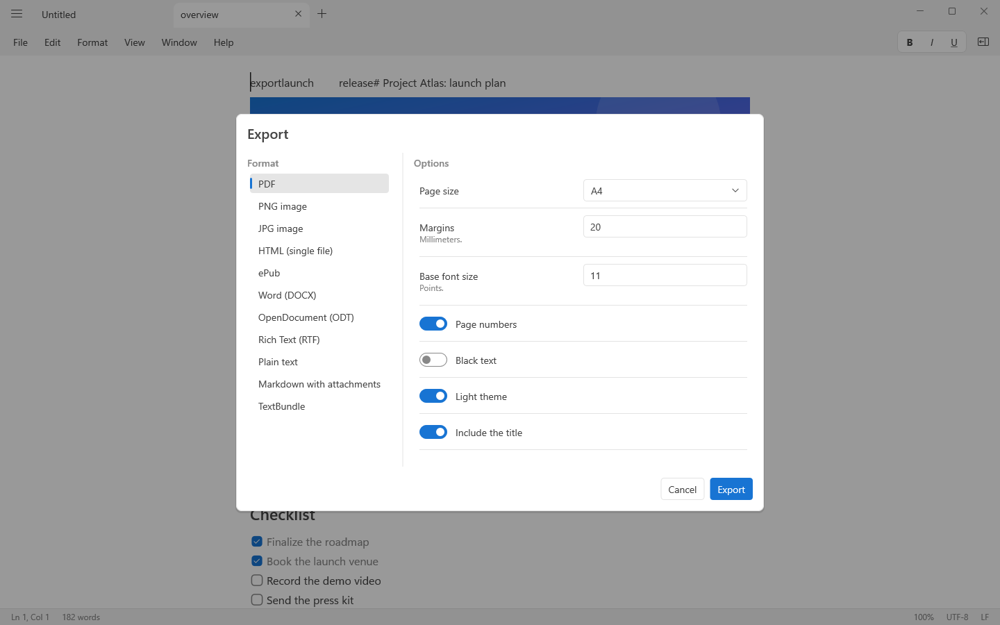
      </picture>
      <br><sub>Export dialog.</sub>
    </td>
    <td width="50%">
      <picture>
        <source media="(prefers-color-scheme: dark)" srcset="docs/screenshots/version-history-dark.png">
        <source media="(prefers-color-scheme: light)" srcset="docs/screenshots/version-history-light.png">
        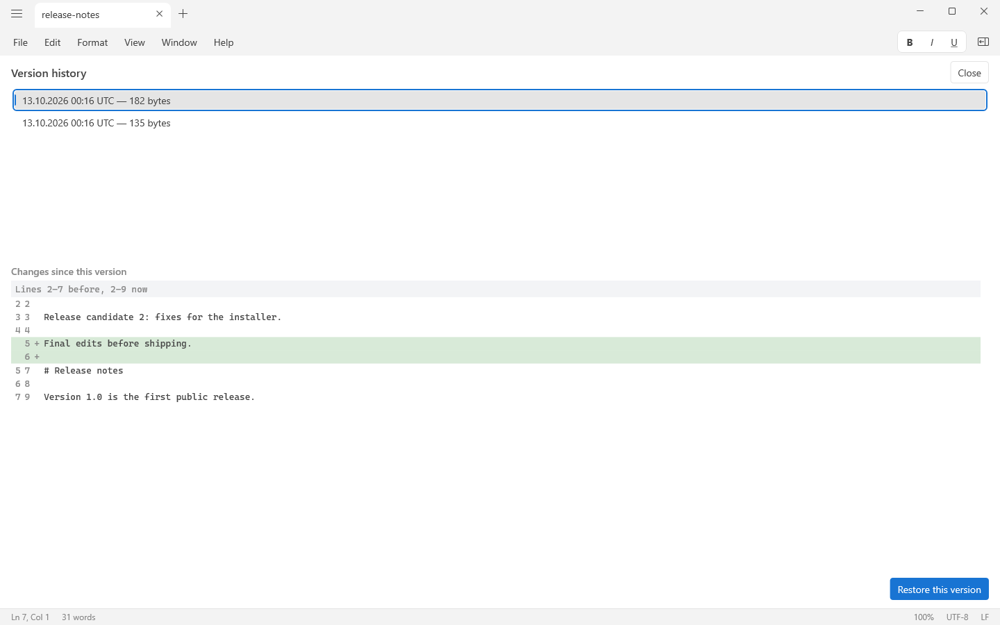
      </picture>
      <br><sub>Version history.</sub>
    </td>
  </tr>
  <tr>
    <td width="50%">
      <picture>
        <source media="(prefers-color-scheme: dark)" srcset="docs/screenshots/plain-text-dark.png">
        <source media="(prefers-color-scheme: light)" srcset="docs/screenshots/plain-text-light.png">
        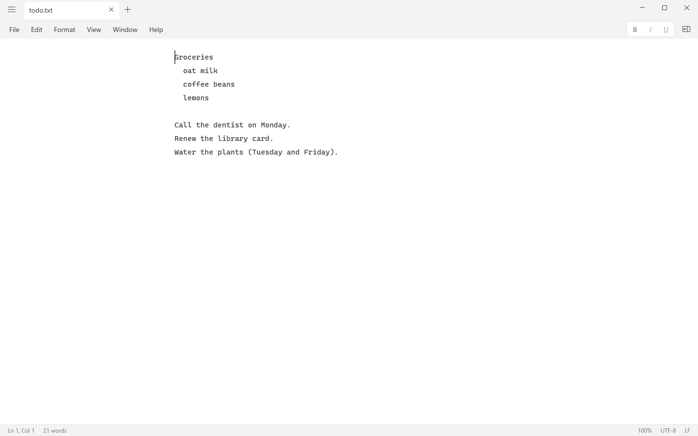
      </picture>
      <br><sub>Plain text mode.</sub>
    </td>
    <td width="50%">
      <picture>
        <source media="(prefers-color-scheme: dark)" srcset="docs/screenshots/settings-appearance-dark.png">
        <source media="(prefers-color-scheme: light)" srcset="docs/screenshots/settings-appearance-light.png">
        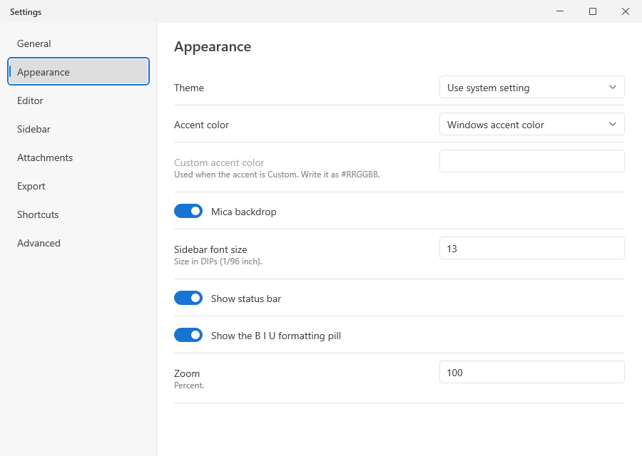
      </picture>
      <br><sub>Settings: Appearance.</sub>
    </td>
  </tr>
  <tr>
    <td width="50%">
      <picture>
        <source media="(prefers-color-scheme: dark)" srcset="docs/screenshots/settings-editor-dark.png">
        <source media="(prefers-color-scheme: light)" srcset="docs/screenshots/settings-editor-light.png">
        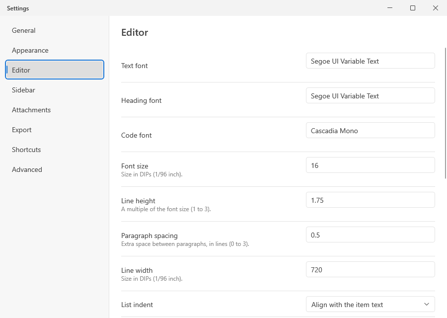
      </picture>
      <br><sub>Settings: Editor.</sub>
    </td>
    <td width="50%"></td>
  </tr>
</table>

## Features

The behavior of each feature is defined in [`docs/spec.md`](docs/spec.md); [`docs/features.toml`](docs/features.toml) ties every feature below to its section.

### Writing

- **Live Markdown rendering** — A WYSIWYG-hybrid editor: Markdown markers hide until the caret touches the element, with the source always one keystroke away.
- **Smart typing** — Lists continue and renumber, Tab indents items, fences and math blocks close themselves, pasted URLs become links, tasks toggle with a click and completed tasks sink to the end.
- **Smart paste** — Images become files, copied files become embeds or attachment chips, Word and browser HTML converts to Markdown, VS Code text stays plain, and Ctrl+Shift+V always pastes plain text.
- **Selection and navigation** — Click, drag, double- and triple-click selection with Unicode word boundaries, drag and drop between tabs, and full keyboard navigation.
- **Undo and redo** — Operation-based history in which typing groups naturally, every command is one step and undo restores the selection.
- **Spell check** — The Windows spell checker with red squiggles, suggestions, Add to dictionary and Ignore, skipping code, URLs, math and front matter.
- **Typewriter, focus, full screen and zen modes** — Typewriter scrolling with a dead zone, focus mode that dims other paragraphs, full screen, zen mode and app-wide zoom.
- **Heading folding** — Fold a section from the gutter chevron; fold state is remembered per file and never written into the document.
- **Formatting pill and selection toolbar** — A B I U pill that reflects the caret state and a selection toolbar with headings, lists, highlight colors, links, tables, images and more.

### Markdown elements

- **Rich Markdown elements** — Headings, emphasis, highlights, tasks, callouts, code blocks, math, Mermaid diagrams, footnotes, front matter, page breaks and more, rendered natively and exported faithfully.
- **Table editing** — Edit cells in place with Tab and Enter navigation, a cell context menu for rows, columns and alignment, copy as Markdown, CSV or HTML, and automatic pipe alignment.
- **Links and wikilinks** — Relative links open inside the app, wikilinks complete with fuzzy matching, missing targets can be created, renames update links, and backlinks are listed in the inspector.
- **Images and attachments** — WIC and SVG images with resize handles, remote images with a cache and safe defaults, attachment chips for other files and configurable attachment folders.

### Files

- **Markdown, text, Office and TextBundle files** — Open and save Markdown, plain text, Mermaid, TextBundle, DOCX, ODT and RTF; import legacy DOC; every import reports what could not be represented. The file type decides how a document is shown: live Markdown, plain lines or a Mermaid diagram.
- **Plain text mode** — Text files such as .txt, logs and source code open as plain lines: every line is shown as written and nothing is rendered; Enter inserts a line break, Tab an indent, and the Markdown formatting commands are off. View → Word wrap wraps long lines at the window edge or lets them run on and scroll sideways, and View → Render as Markdown shows the file as live Markdown without changing how it is saved.
- **Mermaid diagram files** — A .mmd file shows its Mermaid source with the live diagram, drawn as a vector, below it.
- **Encodings and line endings** — Automatic encoding detection including legacy code pages, BOM and original line endings preserved on save, status bar menus to reopen or save with another encoding, and a line-ending menu (LF, CRLF, CR).
- **Autosave and safe saving** — Autosave after a pause, atomic writes, retries on sharing violations, read-only handling, external change detection with diff-based reload, and OneDrive placeholders that are never hydrated by indexing.
- **New and untitled documents** — Create documents inside a workspace with inline rename, or keep unsaved buffers in the session with periodic backup; opening a file replaces an Untitled tab that was never used instead of adding a tab beside it.
- **Version history** — Deduplicated snapshots with a history panel to list, diff and restore, kept for 30 days by default.
- **Crash recovery** — Emergency save of unsaved documents on a crash and an offer to recover them at the next launch; a local rolling log and no telemetry.

### Workspace and navigation

- **Workspace sidebar** — A live file tree with sorting and filters, context menu actions, drag and drop, a background index and Recycle Bin deletion.
- **Tabs, windows and session restore** — Draggable tabs that move between windows, shared documents across tabs, single instance behavior and full session restore.
- **Window menu** — New window, Merge all windows (moves the tabs of every other window into the current one) and the tab commands in one menu.
- **Find, replace and Quick Open** — Find with case, word and regex options, replace all as one undo step, go to line, fuzzy Quick Open for files and headings, and search across a folder.
- **Command palette** — Every command with its shortcut, also reachable as the > mode of Quick Open; commands that do not apply to the current document are listed disabled and do not run.
- **Inspector and status bar** — A contents tree with level filter, document statistics, file information, backlinks and a status bar with caret position, word count, zoom, and clickable encoding and line-ending menus.

### Output

- **Copy, share, export and print** — Copy as Markdown, HTML, rich text or plain text, share files, export to PDF, PNG, JPG, HTML, ePub, DOCX, ODT, RTF, TXT, Markdown with attachments and TextBundle, and print through the system dialog.

### Windows, settings and distribution

- **Native Windows 11 window** — Custom title bar with tabs, Mica Alt backdrop, system light and dark themes with live accent color, high contrast support, per-monitor DPI and native menus.
- **Settings** — Human-editable settings with a settings window for general, appearance, editor, sidebar, attachments, export, shortcuts and advanced options.
- **Keyboard shortcuts** — A complete default keymap without Ctrl+Alt conflicts, every command rebindable, with conflicts flagged.
- **Windows integration** — File associations, an Open with SS Writer folder verb, a Jump List, an Explorer preview pane, touch and pen input, IME and dictation support and UI Automation for every control.
- **Default apps button** — Settings > General > Default apps… opens the Windows page where you choose which app opens Markdown and text files; the installer offers SS Writer under Open with but never takes over a default.
- **Installer, portable zip and updates** — A per-user MSI that needs no administrator rights, a portable zip, a winget package and a weekly update notification that can be turned off.

## Install

Download the files of a release from the [Releases page](https://github.com/isolmaz/ss-writer/releases). Each release carries these files (and the winget manifests of that release):

| Asset | What it is |
|---|---|
| `SSWriter-<version>-x64.msi` | Per-user installer |
| `SSWriter-<version>-x64-portable.zip` | Portable build |
| `SHA256SUMS.txt` | SHA-256 checksums of the two files above |

### winget

```powershell
winget install isolmaz.SSWriter
```

### MSI (per user)

1. Run `SSWriter-<version>-x64.msi`. It needs no administrator rights: SS Writer is installed to `%LOCALAPPDATA%\Programs\SS Writer`, everything it registers goes under `HKCU`, and a Start menu entry is added.
2. For a silent install: `msiexec /i SSWriter-<version>-x64.msi /qn`.

The installer adds SS Writer to **Open with** for `.md`, `.markdown`, `.mdx`, `.mmd`, `.txt`, `.textbundle`, `.textpack`, `.docx`, `.doc`, `.odt` and `.rtf`, adds the folder context menu entry **Open with SS Writer**, and registers the Explorer preview pane for `.md`, `.markdown` and `.mmd`. It does not change any default app; choose SS Writer in **Settings > Apps > Default apps**, or use **Settings > General > Default apps…** inside SS Writer, which opens that page.

A newer MSI replaces an older one in place. Uninstall from **Settings > Apps > Installed apps**; your settings and data in `%APPDATA%\SS Writer` and `%LOCALAPPDATA%\SS Writer` are kept.

### Portable zip

Unzip `SSWriter-<version>-x64-portable.zip` anywhere and run `SSWriter.exe`. The empty `portable` file next to the executable makes SS Writer keep its settings and data in a `data` folder beside it, so it can live on a USB drive. The zip registers nothing: file associations, the folder context menu entry and the preview pane come with the MSI.

### Verify a download

```powershell
Get-FileHash .\SSWriter-<version>-x64.msi -Algorithm SHA256
```

Compare the hash (case-insensitively) with the line for the file in `SHA256SUMS.txt`.

## System requirements

- Windows 11 22H2 (build 22621) or later, x64. There are no Windows 10 code paths: the installer refuses an older build, and the executable shows a message and exits.
- No administrator rights.

## Keyboard shortcuts

Every command can be rebound in **Settings > Shortcuts**, and conflicts are flagged. No default shortcut uses Ctrl+Alt, so AltGr layouts type text normally. The complete table is in [`docs/spec.md`](docs/spec.md#11-keyboard); **Help > Keyboard shortcuts** shows the current bindings.

| Action | Shortcut |
|---|---|
| New file / New window | `Ctrl+N` / `Ctrl+Shift+N` |
| Open file / Open folder | `Ctrl+O` / `Ctrl+Shift+O` |
| Save / Save as | `Ctrl+S` / `Ctrl+Shift+S` |
| Print | `Ctrl+P` |
| New tab / Close tab / Reopen closed tab | `Ctrl+T` / `Ctrl+W` / `Ctrl+Shift+T` |
| Next / previous tab | `Ctrl+Tab`, `Ctrl+PgDn` / `Ctrl+Shift+Tab`, `Ctrl+PgUp` |
| Undo / Redo | `Ctrl+Z` / `Ctrl+Y`, `Ctrl+Shift+Z` |
| Paste as plain text | `Ctrl+Shift+V` |
| Find / Replace / Go to line | `Ctrl+F` / `Ctrl+H` / `Ctrl+G` |
| Find next / previous | `F3` / `Shift+F3` |
| Quick Open / Command palette / Search in folder | `Ctrl+E` / `Ctrl+Shift+P` / `Ctrl+Shift+F` |
| Bold / Italic / Underline | `Ctrl+B` / `Ctrl+I` / `Ctrl+U` |
| Highlight / Strikethrough | `Ctrl+Shift+H` / `Ctrl+Shift+X` |
| Inline code / Code block | `Ctrl+Shift+C` / `Ctrl+Shift+K` |
| Link / Toggle task | `Ctrl+K` / `Ctrl+.` |
| Heading 1 to 6 (again: paragraph) | `Ctrl+1` … `Ctrl+6` |
| Sidebar / Inspector | `Ctrl+Shift+E` / `Ctrl+Shift+I` |
| Typewriter mode / Focus mode | `F9` / `Shift+F9` |
| Full screen / Zen mode | `F11` / `Shift+F11` |
| Insert date | `F5` |
| Zoom in / out / reset | `Ctrl+=` / `Ctrl+-` / `Ctrl+0` |
| Recenter caret | `Ctrl+L` |
| Settings | `Ctrl+,` |
| Next pane | `F6` |

Cut, copy, paste and select all (`Ctrl+X`, `Ctrl+C`, `Ctrl+V`, `Ctrl+A`) and the caret movement keys are handled by the editor itself. `Ctrl+click` opens a link, `Ctrl+wheel` zooms, and `F2` renames the selected item in the sidebar.

## File formats

| Format | Open | Save | Notes |
|---|---|---|---|
| `.md` `.markdown` `.mdx` | yes | yes | Markdown, shown with live rendering |
| `.txt` and other text files (`.log`, `.csv`, `.json`, `.yaml`, `.ini`, `.toml`, source code…) | yes | yes | Plain text mode: shown as written, nothing rendered; View → Word wrap and View → Render as Markdown |
| `.mmd` | yes | yes | Mermaid source with a live diagram |
| `.textbundle` `.textpack` | yes | yes | TextBundle |
| `.docx` | yes | yes | Imported as Markdown; **Save back to Word** writes it back to Word format |
| `.odt` | yes | yes | Same model as DOCX |
| `.rtf` | yes | yes | Same model as DOCX |
| `.doc` (Word 97–2003) | yes | no | Import only; save as `.docx` or `.md`. Encrypted files and Word 6/95 files are rejected with a message |

Every import reports what could not be represented (merged cells, headers and footers, columns, text boxes, comments, tracked changes, VML shapes, unsupported equations) in a banner with a details list. Word equations are converted to LaTeX where possible.

**Export** (File > Export): PDF, PNG, JPG, HTML (single file with embedded CSS and images), ePub, DOCX, ODT, RTF, TXT, Markdown with attachments and TextBundle, with options for page size (A4 or Letter), margins, base font size, page numbers, black text, light theme and title. A diagram can be exported as PNG or SVG from its context menu. **Print** uses the system print dialog.

**Encodings:** UTF-8, UTF-16, UTF-32 and legacy code pages are detected automatically; the encoding, BOM and line-ending style of a file are kept when you save it. Click the encoding or the line ending in the status bar to reopen or save the file with another one.

## Privacy

- **No telemetry.** SS Writer has no analytics, no accounts and no crash upload. Settings, session, version history, the rolling log, crash dumps and recovered documents stay on your PC: `%APPDATA%\SS Writer\settings.json` and `%LOCALAPPDATA%\SS Writer\` (or the `data` folder next to the executable in portable mode).
- **Update check.** At most once a week SS Writer asks the GitHub releases API of this repository (`https://api.github.com/repos/isolmaz/ss-writer/releases/latest`) for the latest version and shows a banner when a newer one exists. Nothing is downloaded until you press Download in that banner: SS Writer then fetches the release's installer, checks it against the release's `SHA256SUMS.txt` and installs it only when you choose "Restart and install", which closes the editor, runs the installer and opens the new version. Turn it off with **Settings > General > Check for updates** (`general.check_for_updates` in `settings.json`). **Help > Check for updates** checks on request.
- **Remote images.** `https` images referenced by a document are loaded by default, without cookies, and cached on disk; `http` images are blocked until you click to load them. Turn loading off for all documents in **Settings > Attachments**, or for one document from its banner.

## Build from source

Requirements: Windows 11 x64, [rustup](https://rustup.rs/) and the Visual Studio Build Tools with the C++ workload. The checkout pins its toolchain in [`rust-toolchain.toml`](rust-toolchain.toml) (Rust 1.98.0 with rustfmt, clippy and llvm-tools-preview, target `x86_64-pc-windows-msvc`); rustup installs it the first time you run cargo in the folder.

```powershell
git clone https://github.com/isolmaz/ss-writer.git
cd ss-writer
cargo build --release
```

This produces `target\release\SSWriter.exe` and the preview handler `target\release\ssw_preview.dll`. `cargo run -p ssw-app` builds and starts a debug build.

To build the release assets (MSI, portable zip, checksums, third-party notices and winget manifests into `dist\`), install [WiX 7](https://wixtoolset.org/) as a .NET tool and run the `dist` task:

```powershell
dotnet tool install --global wix --version 7.0.0
cargo xtask dist --accept-wix-eula
```

WiX 7 asks you to accept its Open Source Maintenance Fee EULA (<https://wixtoolset.org/osmf/>); `--accept-wix-eula` accepts it on your behalf, so read it first. The other `cargo xtask` commands (coverage, mutation tests, documentation check, icons, performance, screenshots) are described in [CONTRIBUTING.md](CONTRIBUTING.md).

## Documentation

- [`docs/spec.md`](docs/spec.md): the product specification, the single source of truth for behavior.
- [`docs/architecture.md`](docs/architecture.md): crates, fixed contracts, platform decisions, threading, storage and engineering rules.
- [`docs/manual-test.md`](docs/manual-test.md): the checklist for what automated tests cannot prove (run before every release).
- [`docs/performance.md`](docs/performance.md): the performance targets, how they are measured and the results.
- [`docs/features.toml`](docs/features.toml): the feature list that ties this README to the specification.
- [`CONTRIBUTING.md`](CONTRIBUTING.md): how to build, test and contribute.
- [`CHANGELOG.md`](CHANGELOG.md): what changed in each release.
- [`assets/THIRD_PARTY.md`](assets/THIRD_PARTY.md): third-party components, fonts and licenses.

Report bugs and ideas on the [issue tracker](https://github.com/isolmaz/ss-writer/issues); **Help > Report an issue** opens the new-issue page.

## License

SS Writer is released under the [MIT License](LICENSE). Third-party components keep their own licenses; see `THIRD-PARTY-NOTICES.txt`, installed next to `SSWriter.exe` and included in the portable zip.
